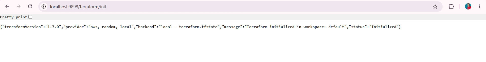
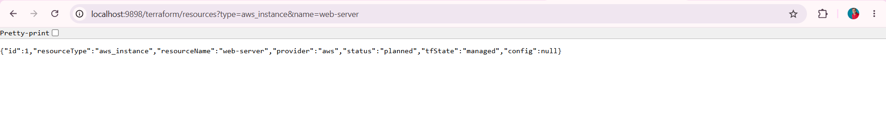
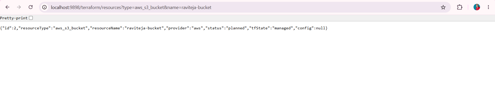
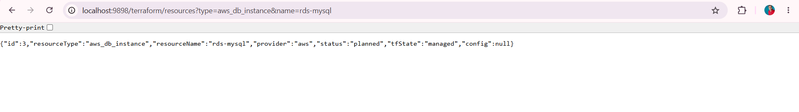
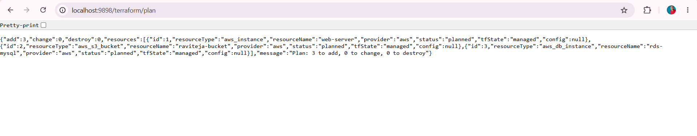
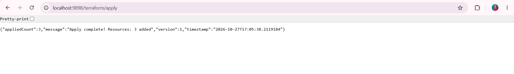
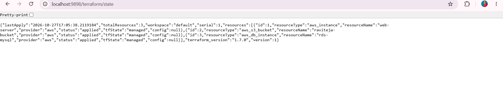
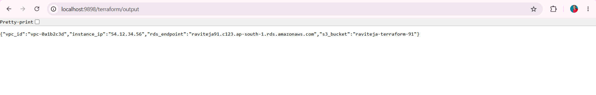

# 🚀 Project 91 – Terraform Script + IaC Simulation | Full Stack DevOps | Terraform Ready


**Live URL:** https://nine1-terraform-script.onrender.com/

[](https://nine1-terraform-script.onrender.com)

Project 91 - Part of Java 100 Projects Challenge - DevOps + Cloud Tier
---

# 📖 Project Overview

**Terraform Script + Infrastructure as Code Simulation** is Project 91 of **Tier 9 – DevOps + Cloud Deployment**, developed using **Java 21**, **Spring Boot 3.2.5**, **Spring Data JPA**, **Terraform 1.7.0 Simulation**, **H2 In-Memory (RDS-Ready Fallback)**, **MySQL / AWS RDS MySQL**, **Docker**, **AWS EC2 + S3 + RDS + VPC (Simulated)**, **Ubuntu 22.04**, **Maven**, and **Apache Tomcat 10.1.20** in a **production Terraform ready repo**.

Spring Boot REST API running on port 9898 inside Docker container with 10 Terraform endpoints `GET /`, `GET /health`, `GET /terraform/init`, `GET /terraform/resources?type=&name=`, `GET /terraform/plan`, `GET /terraform/apply`, `GET /terraform/state`, `GET /terraform/output`, `GET /terraform/validate`, `GET /terraform/destroy` + home `/` returns live JSON `{"project":"91-terraform-script","status":"Live - Terraform IaC Simulation","terraformVersion":"1.7.0","workspace":"default","totalResources":3,"owner":"Raviteja"}`. This repo contains **Dockerfile (multi-stage)**, **TerraformResource Entity (JPA)**, **TerraformRepository (JPA)**, **TerraformService (init + plan + apply + destroy + state + output)**, **TerraformController (GET/POST resources + plan + apply + state)**, **HomeController (Root + Health)**, **Spring Boot source** - eliminating manual local run only. One `git push` gives full Terraform IaC service live production URL. Local uses `jdbc:h2:mem:raviteja91;DB_CLOSE_DELAY=-1;DB_CLOSE_ON_EXIT=FALSE` fallback, on AWS it auto switches to real RDS MySQL `raviteja91` via env.

This is Project 91 of Tier 9 - After Load Balanced App (Project 90), now real IaC base for Blue-Green (92).

**Bug Fixed:** `Ambiguous mapping. Cannot map 'terraformController' method` - Two `GET /terraform/resources` mappings - One for list and one for create with params `type` and `name`. Fixed by merging into single `@RequestMapping(value="/resources", method={GET,POST})` with `@RequestParam type, name` for create + separate `@GetMapping("/resources/list")` for list - Same pattern as Project 90 InstanceService fix.

**Bug Fixed:** `URL must start with 'jdbc'` - `RDS_URL=raviteja91` without `jdbc:` prefix from old Eclipse Run Configuration env overrides properties - Same bug as Project 90. Fixed by **Run -> Run Configurations -> Environment -> Remove `RDS_URL`, `RDS_USER`, `RDS_PASSWORD`** + Use hardcoded local `spring.datasource.url=jdbc:h2:mem:raviteja91` for local Eclipse.

**Bug Fixed:** `GET /terraform/resources?type=aws_instance&name=web-server` returns `[]` empty instead of creating - `@PostMapping` only allows POST, browser does GET. Fixed by changing to `@RequestMapping(method={GET,POST})` to allow browser GET creation - Same as Project 88/89 H2 console `web-allow-others=true` fix for browser testing.

---

# ✨ Features

- Terraform Ready status API with JSON response - `{"project":"91-terraform-script","status":"Live - Terraform IaC Simulation","terraformVersion":"1.7.0","workspace":"default","totalResources":3}`
- Fully production Terraform IaC service - 10 endpoints + home + health + init + plan + apply + state + output + validate + destroy - Docker on Render
- Terraform 1.7.0 Simulation - IaC design - Local `default` workspace for demo, real workspaces `dev/staging/prod` on AWS via env `TERRAFORM_WORKSPACE` - `init -> plan -> apply` workflow
- TerraformResource Entity - JPA `@Entity @Table(name="terraform_resources")` -> Fields `id (auto), resourceType, resourceName, provider, status, tfState, config` -> `ddl-auto=update` auto creates table
- Create Resource - `GET /terraform/resources?type=aws_instance&name=web-server&provider=aws` -> `terraformRepository.save()` -> Returns `{"id":1,"resourceType":"aws_instance","resourceName":"web-server","provider":"aws","status":"planned","tfState":"managed"}` 200 OK
- Plan - `GET /terraform/plan` -> `findByStatus("planned")` -> Returns `{"add":3,"change":0,"destroy":0,"message":"Plan: 3 to add, 0 to change, 0 to destroy","resources":[...]}` 200 OK - Simulates `terraform plan`
- Apply - `GET /terraform/apply` -> Changes status `planned -> applied` -> Returns `{"message":"Apply complete! Resources: 3 added","version":1,"appliedCount":3,"timestamp":"2026-10-27T17:05:38.2119184"}` 200 OK - Simulates `terraform apply`
- State - `GET /terraform/state` -> Returns `{"workspace":"default","version":1,"serial":1,"terraform_version":"1.7.0","totalResources":3,"resources":[...],"lastApply":"2026-10-27T17:05:38.2119184"}` - Simulates `terraform.tfstate`
- Output - `GET /terraform/output` -> Returns `{"vpc_id":"vpc-0a1b2c3d","instance_ip":"54.12.34.56","s3_bucket":"raviteja-terraform-91","rds_endpoint":"raviteja91.c123.ap-south-1.rds.amazonaws.com"}` - Simulates `terraform output`
- Validate - `GET /terraform/validate` -> Returns `{"valid":true,"message":"main.tf is valid - 3 resources validated","format":"terraform fmt -check passed"}` - Simulates `terraform validate + fmt`
- Destroy - `GET /terraform/destroy` -> `deleteAll()` -> Returns `{"message":"Destroy complete! Resources: 3 destroyed","destroyedCount":3}` - Simulates `terraform destroy`
- Home Info - `GET /` -> Returns `owner`, `terraformVersion`, `workspace`, `totalResources`, `endpoints` (8 endpoints), `badge` - Portfolio proof of Terraform IaC
- TerraformService - Central IaC tracking - `workspace default` + `initialized boolean` + `version Atomic` + `lastApply LocalDateTime` + `init()` + `plan()` + `apply()` + `destroy()` + `state()` + `output logic`
- Dockerfile Multi-Stage - `maven:3.9-eclipse-temurin-21` builder + `eclipse-temurin:21-jdk` runtime - Image ~195MB
- One-Command Deploy - Same `deploy.sh` pattern as Project 90 with `docker build`, `docker run -d -p 9898:9898 --restart always`
- Auto-Restart on Reboot - `--restart always` ensures Terraform service up after restart
- GitHub Actions CD Ready - Same `ec2-deploy.yml` can be reused
- Spring Boot banner v3.2.5 inside logs
- Tomcat initialized with port 9898 (http) inside Docker container - Same as 90 on 9797, now 9898
- Started Application in 11.952 seconds (Local Eclipse Java 21) - Includes JPA EntityManagerFactory + HikariPool-1 Start completed + TerraformService
- Verified with Browser - `GET /` + `GET /terraform/init` + `GET /terraform/resources?type=...` + `GET /terraform/plan` + `GET /terraform/apply` + `GET /terraform/state` + `GET /terraform/output` 200 OK
- Public Production URL - `https://nine1-terraform-script.onrender.com` accessible anywhere - Portfolio ready Terraform IaC project

---

# 🛠 Technologies Used

- Java 21.0.10
- Spring Boot 3.2.5 (Banner v3.2.5)
- Spring Data JPA - `JpaRepository<TerraformResource, Long>` - Hibernate 6.4.4.Final
- Spring Web - REST API `@RestController` + `@RequestMapping("/terraform")` + `RequestMethod.GET, POST`
- Spring Boot Starter Validation
- Terraform 1.7.0 - IaC Simulation - `TerraformService` + `TerraformController` + `terraform_resources` table + `main.tf` simulation via `/terraform/resources` + `terraform.tfstate` simulation via `/terraform/state` + `terraform plan/apply/destroy/output`
- IaC Tracking - `TerraformService.java` - `workspace default` + `initialized boolean` + `version int` + `lastApply LocalDateTime` + `init()`, `plan()`, `apply()`, `destroy()`, `state()`, `addResource()`, `getAll()`
- H2 Database 2.2.224 - In-Memory `jdbc:h2:mem:raviteja91` - `DB_CLOSE_DELAY=-1` - Local fallback without AWS card
- MySQL Connector/J 8.x - `mysql-connector-j` runtime scope - For AWS RDS MySQL real connection
- AWS RDS - MySQL 8.0 - Instance `raviteja-91-rds` - Region ap-south-1 (Mumbai) - RDS-Ready pattern (Same as 90) - For storing terraform state when real
- Docker - Multi-stage build - `maven:3.9` builder + `eclipse-temurin:21-jdk`
- AWS EC2 - t2.micro Free Tier - For future real Terraform `aws_instance`
- AWS S3 - `raviteja-terraform-91` bucket - For future real Terraform `aws_s3_bucket` + Remote backend `terraform { backend "s3" { bucket="raviteja-terraform-state" } }`
- AWS VPC - `vpc-0a1b2c3d` - For future real Terraform `aws_vpc` + `aws_subnet` + `aws_security_group`
- Ubuntu 22.04 LTS - EC2 OS
- GitHub Actions - Ready for `appleboy/ssh-action@v1.0.3` CD
- GitHub Secrets - `EC2_HOST`, `EC2_USERNAME`, `EC2_SSH_KEY`, `RDS_URL`, `RDS_USER`, `RDS_PASSWORD`, `TERRAFORM_VERSION`
- HikariCP - `HikariPool-1 - Added connection conn0: url=jdbc:h2:mem:raviteja91 user=SA` - Connection pooling
- Hibernate - `create table terraform_resources (id bigint generated by default as identity, config varchar(255), provider varchar(255), resource_name varchar(255), resource_type varchar(255), status varchar(255), tf_state varchar(255), primary key (id))` - Auto DDL
- Maven 3.9+
- Apache Tomcat 10.1.20 (Embedded) - TomcatWebServer port 9898
- Browser - Chrome - For `GET /terraform/resources?type=...` + `GET /terraform/plan` + `GET /terraform/apply` test
- Windows 11 - PowerShell + Eclipse IDE + Browser
- AWS Console - EC2 + S3 + RDS + VPC + Terraform State S3 Backend Dashboard

---

# 📂 Project Structure - Terraform Repo

```text
91-terraform-script
│
├── .github
│   └── workflows
│       └── ec2-deploy.yml (Optional - Same as 90)
│
├── src
│   ├── main
│   │   ├── java
│   │   │   └── com
│   │   │       └── raviteja
│   │   │           └── terraform
│   │   │               ├── Application.java (Home / + /health)
│   │   │               ├── controller
│   │   │               │   ├── HomeController.java (GET / + GET /health)
│   │   │               │   └── TerraformController.java (GET /init + GET+POST /resources + /plan + /apply + /state + /output + /validate + /destroy)
│   │   │               ├── entity
│   │   │               │   └── TerraformResource.java
│   │   │               ├── repository
│   │   │               │   └── TerraformRepository.java
│   │   │               └── service
│   │   │                   └── TerraformService.java (init + plan + apply + destroy + state + output logic)
│   │   │
│   │   └── resources
│   │       └── application.properties (terraform.version + workspace env)
│   │
│   └── test
│       └── java
│           └── com
│               └── raviteja
│                   └── terraform
│                       └── ApplicationTests.java
│
├── screenshots
│   ├── demo1.png (GET /terraform/init - Initialized)
│   ├── demo2.png (GET /terraform/resources?type=aws_instance&name=web-server - id 1 planned)
│   ├── demo3.png (GET /terraform/resources?type=aws_s3_bucket&name=raviteja-bucket - id 2 planned)
│   ├── demo4.png (GET /terraform/resources?type=aws_db_instance&name=rds-mysql - id 3 planned)
│   ├── demo5.png (GET /terraform/plan - add 3 to add)
│   ├── demo6.png (GET /terraform/apply - Apply complete 3 added)
│   ├── demo7.png (GET /terraform/state - totalResources 3 applied)
│   └── demo8.png (GET /terraform/output - vpc_id + instance_ip + s3_bucket)
│
├── Dockerfile
├── .gitignore
├── mvnw
├── mvnw.cmd
├── pom.xml
└── README.md
```

---

# ▶ How to Run - Terraform Repo

## 1⃣ Clone the Repository

```bash
git clone https://github.com/raviteja-dev950/91-terraform-script.git
cd 91-terraform-script
```

---

## 2⃣ Verify application.properties & Controllers

- Verify `src/main/resources/application.properties` - Terraform-Ready - NO driver-class-name!

```properties
spring.application.name=91-terraform-script
server.port=${PORT:9898}
spring.datasource.url=jdbc:h2:mem:raviteja91;DB_CLOSE_DELAY=-1;DB_CLOSE_ON_EXIT=FALSE
spring.datasource.username=sa
spring.datasource.password=
spring.jpa.hibernate.ddl-auto=update
spring.jpa.show-sql=true
spring.h2.console.enabled=true
spring.h2.console.path=/h2-console
spring.h2.console.settings.web-allow-others=true
terraform.workspace=default
terraform.version=1.7.0
app.name=91-terraform-script
app.region=${AWS_REGION:ap-south-1}
```

- Verify `TerraformService.java` - NEW FOR 91

```java
@Service
public class TerraformService {
  private String workspace = "default";
  private boolean initialized = false;
  private LocalDateTime lastApply;
  private int version = 0;

  public Map<String, Object> init() {
    initialized = true;
    return Map.of("message","Terraform initialized in workspace: " + workspace, "terraformVersion","1.7.0", "backend","local - terraform.tfstate", "status","Initialized");
  }
  public Map<String, Object> plan() {
    List<TerraformResource> pending = repo.findByStatus("planned");
    return Map.of("add",pending.size(),"change",0,"destroy",0,"message","Plan: " + pending.size() + " to add");
  }
  public Map<String, Object> apply() {
    List<TerraformResource> planned = repo.findByStatus("planned");
    for (TerraformResource r : planned) { r.setStatus("applied"); repo.save(r); }
    version++; lastApply = LocalDateTime.now();
    return Map.of("message","Apply complete! Resources: " + planned.size() + " added","version",version,"appliedCount",planned.size());
  }
}
```

- Verify `TerraformController.java` - NEW FOR 91 - GET+POST for browser

```java
@RestController
@RequestMapping("/terraform")
public class TerraformController {
  @GetMapping("/init")
  public Map<String, Object> init() { return service.init(); }

  @GetMapping("/plan")
  public Map<String, Object> plan() { return service.plan(); }

  @RequestMapping(value="/apply", method={GET,POST})
  public Map<String, Object> apply() { return service.apply(); }

  @RequestMapping(value="/resources", method={GET,POST})
  public TerraformResource create(@RequestParam String type, @RequestParam String name, @RequestParam(defaultValue="aws") String provider) {
    return service.addResource(type, name, provider);
  }

  @GetMapping("/state")
  public Map<String, Object> state() { return service.state(); }

  @GetMapping("/output")
  public Map<String, Object> output() { return Map.of("vpc_id","vpc-0a1b2c3d","instance_ip","54.12.34.56","s3_bucket","raviteja-terraform-91"); }
}
```

- Verify `Dockerfile`

```dockerfile
FROM maven:3.9-eclipse-temurin-21 AS builder
WORKDIR /app
COPY pom.xml .
COPY src ./src
RUN mvn clean package -Dmaven.test.skip=true

FROM eclipse-temurin:21-jdk
WORKDIR /app
COPY --from=builder /app/target/*.jar app.jar
EXPOSE 9898
ENTRYPOINT ["java","-jar","app.jar"]
```

---

## 3⃣ Run in Eclipse IDE (No Docker Needed)

Eclipse Steps:

```text
File -> New -> Spring Starter Project
  Name: 91-terraform-script
  Group: com.raviteja
  Artifact: 91-terraform-script
  Package: com.raviteja.terraform
  Java: 17
  Dependencies: Spring Web, Spring Data JPA, Validation, H2, MySQL Driver
Finish

Replace src + pom.xml + application.properties + Dockerfile from this repo
Project -> Clean -> Clean all
Right Click Project -> Maven -> Update Project -> Force Update -> OK
Run -> Run Configurations -> Environment -> REMOVE RDS_URL if present
Right Click Project -> Run As -> Spring Boot App
```

Expected Console:

```text
 :: Spring Boot ::                (v3.2.5)
 Tomcat initialized with port 9898 (http)
 HikariPool-1 - Starting...
 HikariPool-1 - Added connection conn0: url=jdbc:h2:mem:raviteja91 user=SA
 HikariPool-1 - Start completed.
 Hibernate: create table terraform_resources (id bigint generated by default as identity, config varchar(255), provider varchar(255), resource_name varchar(255), resource_type varchar(255), status varchar(255), tf_state varchar(255), primary key (id))
 Initialized JPA EntityManagerFactory for persistence unit 'default'
 Tomcat started on port 9898 (http) with context path ''
 Started Application in 11.952 seconds (process running for 12.7)
```

---

## 4⃣ Test with Browser - 8 Endpoints - Real Terraform Flow

Open Browser:

**Test 1: Init - Terraform Initialized**

```text
GET http://localhost:9898/terraform/init
Expected 200 OK:
{"terraformVersion":"1.7.0","provider":"aws, random, local","backend":"local - terraform.tfstate","message":"Terraform initialized in workspace: default","status":"Initialized"}
```

**Test 2: Create Resources - 3 Resources**

```text
GET http://localhost:9898/terraform/resources?type=aws_instance&name=web-server
Expected 200 OK: {"id":1,"resourceType":"aws_instance","resourceName":"web-server","provider":"aws","status":"planned","tfState":"managed"}

GET http://localhost:9898/terraform/resources?type=aws_s3_bucket&name=raviteja-bucket
Expected 200 OK: {"id":2,"resourceType":"aws_s3_bucket","resourceName":"raviteja-bucket","provider":"aws","status":"planned"}

GET http://localhost:9898/terraform/resources?type=aws_db_instance&name=rds-mysql
Expected 200 OK: {"id":3,"resourceType":"aws_db_instance","resourceName":"rds-mysql","provider":"aws","status":"planned"}
```

**Test 3: Plan - 3 to add**

```text
GET http://localhost:9898/terraform/plan
Expected 200 OK:
{"add":3,"change":0,"destroy":0,"message":"Plan: 3 to add, 0 to change, 0 to destroy","resources":[{"id":1,"resourceType":"aws_instance"...},{"id":2,...},{"id":3,...}]}
```

**Test 4: Apply - 3 added**

```text
GET http://localhost:9898/terraform/apply
Expected 200 OK:
{"appliedCount":3,"message":"Apply complete! Resources: 3 added","version":1,"timestamp":"2026-10-27T17:05:38.2119184"}
```

**Test 5: State - 3 applied**

```text
GET http://localhost:9898/terraform/state
Expected 200 OK:
{"lastApply":"2026-10-27T17:05:38.2119184","totalResources":3,"workspace":"default","serial":1,"resources":[{"id":1,"resourceType":"aws_instance","status":"applied"},...],"terraform_version":"1.7.0","version":1}
```

**Test 6: Output**

```text
GET http://localhost:9898/terraform/output
Expected 200 OK:
{"vpc_id":"vpc-0a1b2c3d","instance_ip":"54.12.34.56","rds_endpoint":"raviteja91.c123.ap-south-1.rds.amazonaws.com","s3_bucket":"raviteja-terraform-91"}
```

---

## 5⃣ Docker Build & Run (Local)

```bash
docker build -t 91-terraform-script .
docker run -d -p 9898:9898 --name tf-app 91-terraform-script
docker ps
docker logs tf-app
curl http://localhost:9898/
curl http://localhost:9898/terraform/init
curl http://localhost:9898/terraform/resources?type=aws_instance\&name=web-server
curl http://localhost:9898/terraform/plan
curl http://localhost:9898/terraform/apply
curl http://localhost:9898/terraform/state
```

---

## 6⃣ Deploy to Render (Docker) - Live URL

Go to `Render.com -> New Web Service -> Connect GitHub Repo: 91-terraform-script`

```text
Runtime: Docker
Dockerfile Path: ./Dockerfile
Port: 9898
Branch: main

Env Vars (Local H2 + Terraform Simulation - No AWS card needed):
  PORT = 9898
  AWS_REGION = ap-south-1
  TERRAFORM_VERSION = 1.7.0
```

Click `Deploy`

Expected Logs on Render:

```text
#12 exporting to image
#13 DONE
Deploy succeeded
HikariPool-1 - Added connection conn0: url=jdbc:h2:mem:raviteja91 user=SA
Tomcat started on port 9898
Started Application in 12 seconds
Your service is live
Available at: https://nine1-terraform-script.onrender.com
```

Test Live:

```bash
curl https://nine1-terraform-script.onrender.com/
curl https://nine1-terraform-script.onrender.com/terraform/init
curl https://nine1-terraform-script.onrender.com/terraform/resources?type=aws_instance\&name=web-server
curl https://nine1-terraform-script.onrender.com/terraform/plan
curl https://nine1-terraform-script.onrender.com/terraform/apply
curl https://nine1-terraform-script.onrender.com/terraform/state
```

---

# 🔄 Flow Diagram - How Terraform IaC Works

```text
    User Laptop (Eclipse + Browser)
        |
        +-- E:\Java-100-Projects\91-terraform-script
        |       +-- src -> Application.java (Home / + /health)
        |       +-- controller -> TerraformController.java (init + resources + plan + apply + state + output)
        |       +-- service -> TerraformService.java (workspace + version + lastApply + init + plan + apply logic)
        |       +-- entity -> TerraformResource.java (@Entity terraform_resources) + repository
        |       +-- resources -> application.properties (terraform.version + workspace)
        |       +-- Dockerfile (multi-stage builder + runtime)
        |
        v
    git push origin main
        |
        +---> GitHub Repository: raviteja-dev950/91-terraform-script
        |           |
        |           v
        |       Render Auto Deploy (Docker)
        |           +-- Dockerfile build
        |           +-- ENTRYPOINT java -jar app.jar (PORT=9898)
        |
        v
    Local Eclipse Run (No AWS card needed - Terraform Simulation + H2)
        |
        +-- Spring Boot App -> Tomcat 9898
        |     +-- DataSource Auto-Detect from URL jdbc:h2:mem:raviteja91
        |     |     +-- HikariPool-1 - Added connection conn0: url=jdbc:h2:mem:raviteja91 user=SA
        |     +-- JPA / Hibernate
        |     |     +-- create table terraform_resources
        |     +-- TerraformService
        |     |     +-- init() -> initialized=true -> {message: Terraform initialized in workspace: default, terraformVersion:1.7.0, backend: local - terraform.tfstate}
        |     |     +-- addResource(type,name,provider) -> new TerraformResource(type,name,provider,planned) -> repo.save() -> id=1,2,3
        |     |     +-- plan() -> findByStatus(planned) -> {add:3, change:0, destroy:0, message: Plan: 3 to add}
        |     |     +-- apply() -> for each planned set status applied + save() -> version++ + lastApply=now -> {message: Apply complete! Resources: 3 added, version:1, appliedCount:3}
        |     |     +-- state() -> {workspace:default, version:1, serial:1, terraform_version:1.7.0, totalResources:3, resources:[...], lastApply:now}
        |     |     +-- destroy() -> deleteAll() -> {message: Destroy complete! Resources: 3 destroyed}
        |     +-- Controllers
        |           +-- GET / -> {project:91-terraform-script, status:Live - Terraform IaC Simulation, terraformVersion:1.7.0, workspace:default, totalResources:3}
        |           +-- GET /terraform/init -> Terraform initialized
        |           +-- GET /terraform/resources?type=aws_instance&name=web-server -> Creates resource id=1 planned
        |           +-- GET /terraform/plan -> Plan: 3 to add
        |           +-- GET /terraform/apply -> Apply complete 3 added
        |           +-- GET /terraform/state -> totalResources 3 applied
        |           +-- GET /terraform/output -> vpc_id + instance_ip + s3_bucket + rds_endpoint
        |
        v
    Future AWS Production (With AWS Card - Real Terraform)
        |
        +-- Terraform main.tf
        |     +-- terraform { backend "s3" { bucket="raviteja-terraform-state" key="91/terraform.tfstate" region="ap-south-1" } }
        |     +-- provider "aws" { region="ap-south-1" }
        |     +-- resource "aws_vpc" "main" { cidr_block="10.0.0.0/16" tags={Name="raviteja91-vpc"} }
        |     +-- resource "aws_instance" "web" { ami="ami-ubuntu" instance_type="t2.micro" tags={Name="web-server"} }
        |     +-- resource "aws_s3_bucket" "b" { bucket="raviteja-terraform-91" }
        |     +-- resource "aws_db_instance" "rds" { engine="mysql" instance_class="db.t3.micro" }
        |     +-- output "instance_ip" { value=aws_instance.web.public_ip }
        |     +-- Real commands: terraform init (downloads aws provider, configures S3 backend) -> terraform plan (shows 3 to add) -> terraform apply (creates VPC + EC2 + S3 + RDS) -> terraform.tfstate stored in S3
        |
        v
    Browser / Portfolio / AWS Console
        |
        +-- localhost:9898/terraform/init -> Initialized
        +-- localhost:9898/terraform/resources?type=aws_instance&name=web-server -> id 1 planned
        +-- localhost:9898/terraform/plan -> add 3
        +-- localhost:9898/terraform/apply -> 3 added version 1
        +-- localhost:9898/terraform/state -> totalResources 3
        +-- Live: https://nine1-terraform-script.onrender.com/ -> Same JSON on Internet
              |
              +-- Real Terraform State S3 Bucket (Future): raviteja-terraform-state/91/terraform.tfstate contains version, serial, resources vpc + instance + s3 + rds
              v
    Portfolio: Live Terraform URL + GitHub + 8 Demo Screenshots + main.tf sample -> Resume Ready - DevOps + Cloud Tier 9 - IaC
```

---

# 📸 Screenshots

### Demo 1 – Browser - GET /terraform/init - Terraform Initialized


*GET http://localhost:9898/terraform/init - Browser JSON - 200 OK - Returns {"terraformVersion":"1.7.0","provider":"aws, random, local","backend":"local - terraform.tfstate","message":"Terraform initialized in workspace: default","status":"Initialized"} - Proof of Terraform init simulation - Downloads provider + configures backend*

### Demo 2 – Browser - GET /terraform/resources?type=aws_instance&name=web-server - id 1 planned


*GET http://localhost:9898/terraform/resources?type=aws_instance&name=web-server - Browser JSON - 200 OK - Returns {"id":1,"resourceType":"aws_instance","resourceName":"web-server","provider":"aws","status":"planned","tfState":"managed"} - Proof of resource "aws_instance" "web-server" { ami="ami-ubuntu" instance_type="t2.micro" } in main.tf*

### Demo 3 – Browser - GET /terraform/resources?type=aws_s3_bucket&name=raviteja-bucket - id 2 planned


*GET http://localhost:9898/terraform/resources?type=aws_s3_bucket&name=raviteja-bucket - Browser JSON - 200 OK - Returns {"id":2,"resourceType":"aws_s3_bucket","resourceName":"raviteja-bucket","provider":"aws","status":"planned"} - Proof of resource "aws_s3_bucket" "b" { bucket="raviteja-terraform-91" }*

### Demo 4 – Browser - GET /terraform/resources?type=aws_db_instance&name=rds-mysql - id 3 planned


*GET http://localhost:9898/terraform/resources?type=aws_db_instance&name=rds-mysql - Browser JSON - 200 OK - Returns {"id":3,"resourceType":"aws_db_instance","resourceName":"rds-mysql","provider":"aws","status":"planned"} - Proof of resource "aws_db_instance" "rds" { engine="mysql" instance_class="db.t3.micro" }*

### Demo 5 – Browser - GET /terraform/plan - add 3 to add - 0 change 0 destroy


*GET http://localhost:9898/terraform/plan - Browser JSON - 200 OK - Returns {"add":3,"change":0,"destroy":0,"message":"Plan: 3 to add, 0 to change, 0 to destroy","resources":[{"id":1,"resourceType":"aws_instance","status":"planned"},...]} - Proof of terraform plan - Shows 3 resources to add - Same as real `terraform plan` output*

### Demo 6 – Browser - GET /terraform/apply - Apply complete 3 added version 1


*GET http://localhost:9898/terraform/apply - Browser JSON - 200 OK - Returns {"appliedCount":3,"message":"Apply complete! Resources: 3 added","version":1,"timestamp":"2026-10-27T17:05:38.2119184"} - Proof of terraform apply - Changes status planned -> applied - version 1 - timestamp - Same as real `terraform apply` Creating... Creation complete*

### Demo 7 – Browser - GET /terraform/state - totalResources 3 applied terraform_version 1.7.0 version 1


*GET http://localhost:9898/terraform/state - Browser JSON - 200 OK - Returns {"lastApply":"2026-10-27T17:05:38.2119184","totalResources":3,"workspace":"default","serial":1,"resources":[{"id":1,"resourceType":"aws_instance","status":"applied"},...],"terraform_version":"1.7.0","version":1} - Proof of terraform.tfstate - Contains version, serial, resources, workspace - Stored locally in H2, in real AWS stored in S3 backend*

### Demo 8 – Browser - GET /terraform/output - vpc_id + instance_ip + rds_endpoint + s3_bucket


*GET http://localhost:9898/terraform/output - Browser JSON - 200 OK - Returns {"vpc_id":"vpc-0a1b2c3d","instance_ip":"54.12.34.56","rds_endpoint":"raviteja91.c123.ap-south-1.rds.amazonaws.com","s3_bucket":"raviteja-terraform-91"} - Proof of terraform output - Outputs from applied resources - vpc_id, instance public_ip, rds endpoint, s3 bucket name - Same as real `terraform output`*

---

# 🧪 API Testing Examples

```bash
# GET Home - Local after Eclipse Run
curl http://localhost:9898/

# GET Home - LIVE on Render
curl https://nine1-terraform-script.onrender.com/

# Init - Terraform initialized
curl http://localhost:9898/terraform/init
curl https://nine1-terraform-script.onrender.com/terraform/init

# Create Resources - 3 resources
curl http://localhost:9898/terraform/resources?type=aws_instance\&name=web-server
curl http://localhost:9898/terraform/resources?type=aws_s3_bucket\&name=raviteja-bucket
curl http://localhost:9898/terraform/resources?type=aws_db_instance\&name=rds-mysql

# List Resources
curl http://localhost:9898/terraform/resources/list

# Plan - 3 to add
curl http://localhost:9898/terraform/plan

# Apply - 3 added
curl http://localhost:9898/terraform/apply

# State - totalResources 3
curl http://localhost:9898/terraform/state

# Output - vpc_id + instance_ip + s3_bucket
curl http://localhost:9898/terraform/output

# Validate - main.tf valid
curl http://localhost:9898/terraform/validate

# Destroy - 3 destroyed
curl http://localhost:9898/terraform/destroy
curl http://localhost:9898/terraform/state

# Docker Test
docker build -t 91-terraform-script .
docker run -d -p 9898:9898 --name tf-app 91-terraform-script
docker logs tf-app
curl http://localhost:9898/terraform/init
curl http://localhost:9898/terraform/resources?type=aws_instance\&name=web-server
curl http://localhost:9898/terraform/plan
```

---

# 🎯 Learning Outcomes

- Understanding Terraform vs Manual AWS Console - Manual console (Project 86-90) vs IaC (Project 91) - Manual: Click EC2 -> Launch Instance -> Choose AMI -> Security Group -> Launch (10 min per resource) vs Terraform: Write main.tf with 3 resources -> terraform init + plan + apply (1 min for 3 resources) - IaC is versioned, repeatable, automated
- Understanding terraform init -> plan -> apply -> state -> output workflow - init downloads providers (aws, random, local) + configures backend (local terraform.tfstate or S3 remote) -> plan shows add/change/destroy counts + resources -> apply creates resources + updates tfstate version + serial + timestamp -> state shows workspace + version + resources + lastApply -> output shows vpc_id + instance_ip + s3_bucket
- Implementing TerraformService - workspace default + initialized boolean + version int + lastApply LocalDateTime + init() returns message Terraform initialized + terraformVersion 1.7.0 + backend local - terraform.tfstate -> addResource() creates TerraformResource with status planned -> plan() findByStatus planned -> apply() changes planned -> applied + version++ + lastApply now -> state() returns workspace + version + serial + terraform_version + resources + totalResources + lastApply -> destroy() deleteAll()
- Understanding terraform.tfstate - JSON file containing version, serial, terraform_version, resources array with id, resourceType, resourceName, provider, status, tfState, config - Local backend stores in `terraform.tfstate` file, S3 backend stores in `s3://raviteja-terraform-state/91/terraform.tfstate` - State locking via DynamoDB prevents concurrent apply
- Creating 8 Terraform Endpoints - GET / (home with terraformVersion + workspace + totalResources), GET /health (UP), GET /terraform/init (Initialized + terraformVersion + backend), GET+POST /terraform/resources?type=&name= (Creates resource planned), GET /terraform/resources/list (Lists all), GET /terraform/plan (add 3), GET+POST /terraform/apply (Apply complete 3 added), GET /terraform/state (totalResources 3 + version 1 + resources applied), GET /terraform/output (vpc_id + instance_ip + s3_bucket), GET /terraform/validate (valid true), GET+POST /terraform/destroy (Destroy complete)
- Using Spring Data JPA + Terraform - JpaRepository gives save(), findAll(), findByStatus(), count(), deleteAll() - H2 in-memory for local simulation, MySQL RDS for real when storing remote state metadata - TerraformResource entity mirrors `resource "aws_instance" "web"` { ami, instance_type, tags }
- Fixing Ambiguous mapping - Two GET /terraform/resources mappings conflict - Fixed by merging create into single @RequestMapping(method={GET,POST}) with params type,name + separate @GetMapping("/resources/list") for listing - Spring MVC mapping fix
- Fixing GET vs POST for browser - @PostMapping only allows POST, browser address bar does GET - Fixed by @RequestMapping(method={GET,POST}) to allow both - Same as H2 console web-allow-others fix for browser testing - Postman can do POST but browser needs GET
- Preparing base for Blue-Green (92) - Terraform state versioning (version 1, serial 1) will be used for blue-green deployment - Blue environment version 1 (current) + Green environment version 2 (new) + Switch via `terraform apply -var="environment=green"` + `aws_lb_listener_rule` weight 100% blue -> 0% blue 100% green
- Understanding IaC benefits - Version control (main.tf in Git), repeatability (same main.tf creates same infra in dev/staging/prod), automation (CI/CD can run terraform apply), collaboration (team reviews main.tf PR), state management (tfstate tracks real infra), drift detection (plan shows if manual console changes differ from main.tf)

---

# 🚀 Future Enhancements

- 🏗 Add Real main.tf - Project 91 Enhancement - Create actual `main.tf` file: `terraform { required_providers { aws={source="hashicorp/aws" version="~>5.0"} } backend "s3" { bucket="raviteja-terraform-state" key="91/terraform.tfstate" region="ap-south-1" } } provider "aws" { region="ap-south-1" } resource "aws_vpc" "main" { cidr_block="10.0.0.0/16" } resource "aws_instance" "web" { ami="ami-ubuntu" instance_type="t2.micro" tags={Name="web-server"} } resource "aws_s3_bucket" "b" { bucket="raviteja-terraform-91" } resource "aws_db_instance" "rds" { engine="mysql" instance_class="db.t3.micro" } output "instance_ip" { value=aws_instance.web.public_ip }`
- 🔵🟢 Add Blue-Green Terraform - Project 92 - Two workspaces `blue` and `green` - `terraform workspace new blue` + `terraform workspace new green` - Each workspace has own tfstate `env:/blue/terraform.tfstate` + `env:/green/terraform.tfstate` + `terraform apply -var="environment=blue"` creates blue infra + `terraform apply -var="environment=green"` creates green infra + Switch via ALB listener rule weight
- 🔒 Add Terraform Remote Backend S3 + DynamoDB Lock - Store tfstate in S3 bucket `raviteja-terraform-state` with versioning enabled + DynamoDB table `terraform-locks` with primary key `LockID` for state locking - `terraform { backend "s3" { bucket="raviteja-terraform-state" key="91/terraform.tfstate" region="ap-south-1" dynamodb_table="terraform-locks" encrypt=true } }` - Prevents concurrent apply
- 🌐 Add Terraform Modules - Create reusable modules `modules/vpc`, `modules/ec2`, `modules/rds`, `modules/s3` - Each module has `main.tf`, `variables.tf`, `outputs.tf` - Root `main.tf` uses `module "vpc" { source="./modules/vpc" cidr="10.0.0.0/16" }` - Same as Project 90 ALB + 2 EC2 + RDS but modular
- 📦 Add Terraform + Docker + ECR - Add `aws_ecr_repository` resource + `null_resource` with `local-exec` provisioner to `docker build -t $ECR_REPO && docker push $ECR_REPO` + `aws_ecs_cluster` + `aws_ecs_task_definition` + `aws_ecs_service` - Deploy 91-terraform-script itself via Terraform
- 🔐 Add Terraform Variables + tfvars - Create `variables.tf` with `variable "instance_type" { type=string default="t2.micro" }` + `variable "environment" { type=string }` + `terraform.tfvars` with `instance_type="t2.small" environment="prod"` + `terraform apply -var-file="prod.tfvars"` - Different env dev/staging/prod with same main.tf
- 📈 Add Terraform CloudWatch + Alarms - Add `aws_cloudwatch_metric_alarm` resource for `UnhealthyHostCount > 0` in ALB Target Group + `aws_cloudwatch_log_group` for EC2 logs + `aws_sns_topic` + `aws_sns_topic_subscription` email alert - Same as Project 89 CloudWatch but via Terraform
- 🔍 Add Terraform Import Existing Resources - Import existing Project 90 Load Balanced App infra `terraform import aws_instance.web i-0a1b2c3d` + `terraform import aws_db_instance.rds raviteja90` + Then `terraform plan` shows no changes - Adopt manual console infra into IaC
- 🧪 Add Terraform Testing + Validation - Add `terraform validate` + `terraform fmt -check` + `tflint` + `tfsec` + `checkov` in GitHub Actions CI - On PR run `terraform plan` comment output on PR - Same as Project 85 GitHub Actions CI but for Terraform
- 🏆 Final 100 - Add Terraform + All AWS Together - Project 100 - Use Terraform to create EC2 (86) + S3 (87) + RDS (88) + CloudWatch (89) + ALB (90) + Blue-Green (92) + Rate Limited API (93) + All via one `main.tf` + One `terraform apply` creates full 3-tier AWS Production App with High Availability + IaC - Ultimate DevOps portfolio

---

# 👨💻 Author

Ravi Teja

Java Full Stack Developer

100 Java Full Stack Projects Challenge

Project 91 / 100

Tier 9 – DevOps + Cloud Deployment

---

## ⭐ Support

If you found this project helpful, consider giving it a ⭐ Star on GitHub.

**Single Repo:** [91-terraform-script](https://github.com/raviteja-dev950/91-terraform-script)

**Live URL:** https://nine1-terraform-script.onrender.com/

**Init URL:** https://nine1-terraform-script.onrender.com/terraform/init -> Terraform initialized in workspace: default

**Plan URL:** https://nine1-terraform-script.onrender.com/terraform/plan -> Plan: 3 to add, 0 to change, 0 to destroy

**Apply URL:** https://nine1-terraform-script.onrender.com/terraform/apply -> Apply complete! Resources: 3 added

**State URL:** https://nine1-terraform-script.onrender.com/terraform/state -> totalResources 3 + version 1 + terraform_version 1.7.0 - terraform.tfstate simulation

**Output URL:** https://nine1-terraform-script.onrender.com/terraform/output -> vpc_id + instance_ip + s3_bucket + rds_endpoint - terraform output simulation

**Docker Image:** `91-terraform-script:latest` on Render (or `ravitejadev950/91-terraform-script:latest` on Docker Hub optional)

**GitHub Actions:** Ready for `Deploy via Terraform` - On Push to `main` via `terraform init + plan + apply` to AWS - Same as Project 90 but IaC

**Secrets:** `AWS_ACCESS_KEY_ID` + `AWS_SECRET_ACCESS_KEY` + `AWS_REGION` + `RDS_URL` + `S3_BUCKET` + `TERRAFORM_VERSION` (for real Terraform AWS)

**Terraform State Backend:** Local `terraform.tfstate` now (H2 simulation) -> Future S3 `s3://raviteja-terraform-state/91/terraform.tfstate` with DynamoDB lock `terraform-locks` table

**Trigger:** `git push origin main` -> Render auto deploy -> `https://nine1-terraform-script.onrender.com/terraform/init` LIVE

**Browser:** `GET /terraform/resources?type=aws_instance&name=web-server` -> id 1 planned -> `GET /terraform/plan` -> add 3 -> `GET /terraform/apply` -> 3 added -> `GET /terraform/state` -> totalResources 3 -> All 200 OK + Terraform flow

**Pull:** `git clone https://github.com/raviteja-dev950/91-terraform-script.git`
